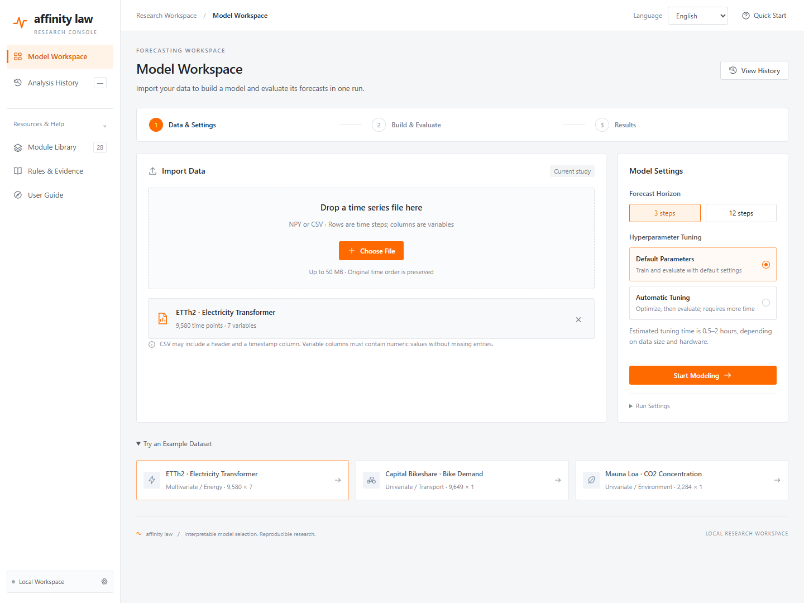
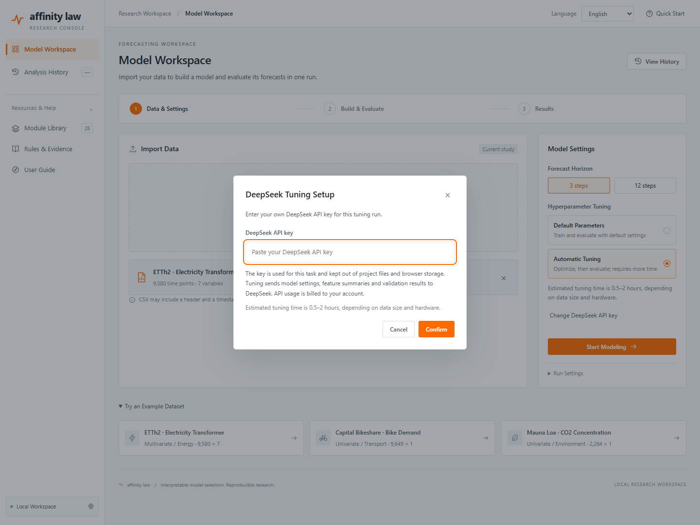
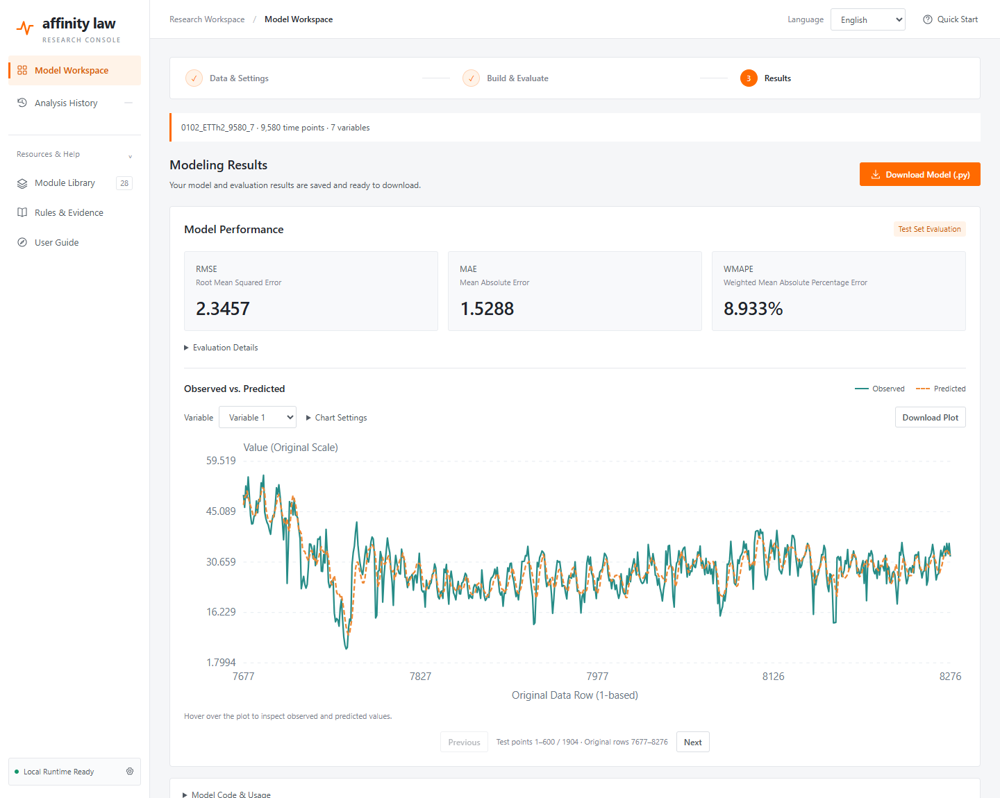

# Architecture affinity in time-series forecasting

This repository provides the code, datasets and reference results for investigating how time-series characteristics relate to forecasting model architectures. The framework represents datasets using seven meta-features derived from 39 statistical features, characterizes models using 24 reusable motifs, and extracts affinity laws from LLM-generated architectures. These laws guide model construction for new forecasting tasks.

The experiments include **263 discovery datasets**, **4,734 retained task–model records**, and **63 external datasets** evaluated at forecasting horizons of **3 and 12 steps**. A local workbench supports custom-data evaluation and optional LLM-assisted hyperparameter tuning.

## Repository structure

| Path | Description |
| --- | --- |
| [0dataset/](0dataset/) | Discovery and external datasets, with precomputed statistical features and meta-features. |
| [1experiment/](1experiment/) | Feature extraction, motif definitions, LLM-guided architecture discovery and training. |
| [2search/](2search/) | Affinity-law discovery and validation, external comparisons, reference models and predictions. |
| [3par/](3par/) | Fixed-architecture hyperparameter tuning and reference results for 126 external tasks. |
| [4html/](4html/) | Local workbench, Python service and example datasets. |
| [docs/images/](docs/images/) | Workbench screenshots. |
| [requirements.txt](requirements.txt) | Pinned dependencies for the research environment. |
| [start_workbench.py](start_workbench.py) | Environment setup and workbench launcher. |

## Installation

Use **64-bit Python 3.11**. Install the PyTorch build appropriate for your CPU or CUDA environment, then install the pinned dependencies. Run the following commands in the activated project environment.

```sh
git clone https://github.com/affinity-law/affinity_law.git
cd affinity_law
python -m pip install -r requirements.txt
```

For the workbench, the launcher can set up and reuse a local Python environment. On Windows, double-click `Start_Workbench.cmd`. On macOS or Linux, run `python3.11 start_workbench.py`. Initial setup requires internet access. CPU execution is supported.

## Reproducing the experiments

Run commands from the repository root. Use a fresh output directory or run name for each independent experiment.

### 1. Check the released inputs

```sh
python -B 2search/connect/04_pooled_all_4734/run.py --check-only
python -B 2search/connect/01_exact_rule_validation/run.py --check-only
python -B 2search/compar_exp/main.py --check-only
```

The released artifacts include discovery records, 27 affinity laws, external comparison results and tuning summaries. [Discovery records](1experiment/result_csv/) · [Affinity laws](2search/connect/document_summary.csv) · [External comparisons](2search/compar_result/) · [Tuning summaries](3par/result/summary_all.csv)

### 2. Discover and validate affinity laws

Run pooled discovery followed by fixed-threshold validation.

```sh
python -B 2search/connect/04_pooled_all_4734/run.py --output-dir outputs/pooled
python -B 2search/connect/01_exact_rule_validation/run.py --pooled-dir outputs/pooled --output-dir outputs/validation
```

### 3. Evaluate a law-guided model

The example below evaluates the Victoria electricity dataset with a three-step forecast horizon and three random seeds.

```sh
python -B 2search/compar_exp/main.py --experiments L --datasets 0113_electricity_vic_9229_1 --horizons 3 --seeds 2026 2027 2028 --output-dir outputs/external_example --skip-summary
```

The comparison methods are **L** (law-guided), **F** (frequency-based), **R** (random architecture selection) and **LLM** (direct LLM design). Use `--help` to inspect dataset, horizon and experiment options.

### 4. Tune a fixed architecture

An offline smoke test uses short training and a mock agent.

```sh
python -B 3par/tune.py --datasets first1 --horizons 3 --trials 2 --run smoke_example --smoke --mock-agent
```

For the full protocol, set `DEEPSEEK_API_KEY` in the terminal environment and run the following command. The protocol screens 32 configurations using two seeds and adds a third seed for the top four configurations and the default. Settings are provided in [3par/settings.json](3par/settings.json).

```sh
python -B 3par/tune.py --datasets all --horizons 3 12 --run full_external
```

<details>
<summary>Feature extraction, architecture discovery and foundation-model comparisons</summary>

Recompute features for an external dataset, or list architecture-discovery tasks.

```sh
python -B 1experiment/compute_metrics.py --split test --datasets 0217_hsr01_inflow3_1008_1 --output-dir outputs/features
python -B 1experiment/run_discovery.py --ai deepseek --datasets all --horizons 3 12 --output-root outputs/discovery --dry-run
```

For live architecture discovery, remove `--dry-run` and set the credential for the selected provider. DeepSeek, ChatGPT and Gemini use `DEEPSEEK_API_KEY`, `OPENAI_API_KEY` and `GEMINI_API_KEY`, respectively.

TimesFM and Moirai adapters are provided in `2search/compar_exp/foundation_model/`. Use a separate Python 3.11 environment with compatible PyTorch and torchvision builds. Install `runtime_support_requirements.txt`, then the remaining packages in `runtime_requirements.txt` with `--no-deps`. The recorded torchvision wheel targets CUDA 12.8. Select a compatible build for your machine.

From the foundation-model directory, run `python prepare_weights.py --download` to retrieve the pinned weights. Run `python experiment_63/run_portable.py --model timesfm3_0 --run new_example` for TimesFM, or select `moirai2_0`. Model cards, provenance and licenses are retained under each model's `checkpoint/` directory.

</details>

## Data and evaluation

Discovery and external datasets are stored as NPY arrays under `0dataset/train/` and `0dataset/test/`. Their corresponding feature tables are under `trainmetrics/` and `testmetrics/`. Reference results are included to support inspection and comparison with new runs.

The default forecasting protocol uses a chronological **60/20/20** train/validation/test split, a **12-step input window**, and seeds **2026, 2027 and 2028**. Training runs for at most **300 epochs**, with early stopping after **15 epochs** without improvement in validation loss. New-data law-guided selection compares up to six candidate architectures by validation RMSE.

Test RMSE, MAE and WMAPE are computed on the original scale after averaging overlapping forecasts. WMAPE is stored as a fraction in CSV/JSON and displayed as a percentage in the workbench. In tuning summaries, `best_*` denotes the validation-selected configuration. Historical `recommended_*` fields also incorporate the original L test comparison. Hardware, numerical libraries and live LLM responses can affect rerun results.

## Local workbench

Launch the interface from the project environment.

```sh
python -B 4html/start.py
```

Open the address printed in the terminal, normally `http://127.0.0.1:8040`. Keep the terminal open during use and press **Ctrl+C** to stop the service. Optional flags include `--port 8041` and `--no-browser`. Computation runs on the user's computer. Opening `4html/index.html` directly provides a static preview of the bundled examples.

Import a CSV or NPY file, select a 3-step or 12-step horizon, and start modeling. The interface provides prediction curves, test metrics, model source code and downloadable reports. Completed runs are stored in `4html/runs/` and can be reopened through History.

CSV accepts an optional header and first timestamp column, followed by numeric measurement columns. NPY accepts numeric arrays shaped `[time]` or `[time, variables]`. Inputs must contain finite values, fit within the 50 MB upload limit and have enough observations for the temporal split and forecasting windows.

### Optional DeepSeek tuning

Select **Automatic Tuning** to enter your own DeepSeek API key in a dialog. Confirm the key, then start modeling. Estimated tuning time is **0.5–2 hours**, depending on data size and hardware. Default law-guided training runs without an API key.

The workbench supports the official DeepSeek API. Credentials are passed to the local worker for the current task and excluded from project files, reports and browser storage. Tuning sends model configurations, feature summaries and validation history to DeepSeek. API usage is billed to the user's account. The model is configured by `agent.model` in [3par/settings.json](3par/settings.json).

### Screenshots

The screenshots show the ETTh2 example and its archived three-seed evaluation.



<details>
<summary>DeepSeek configuration and forecasting results</summary>





</details>

## Verification

```sh
python -B 2search/connect/support/test_connect.py
python -B -m unittest discover -s 3par -p "test_*.py"
python -B 4html/verify.py
```

The workbench checks include a local HTTP test that requires loopback network access. Generated runs, local environments and credential files are covered by `.gitignore`.

## License

The project code is released under the [MIT License](LICENSE). Third-party models and source datasets retain their respective terms.

